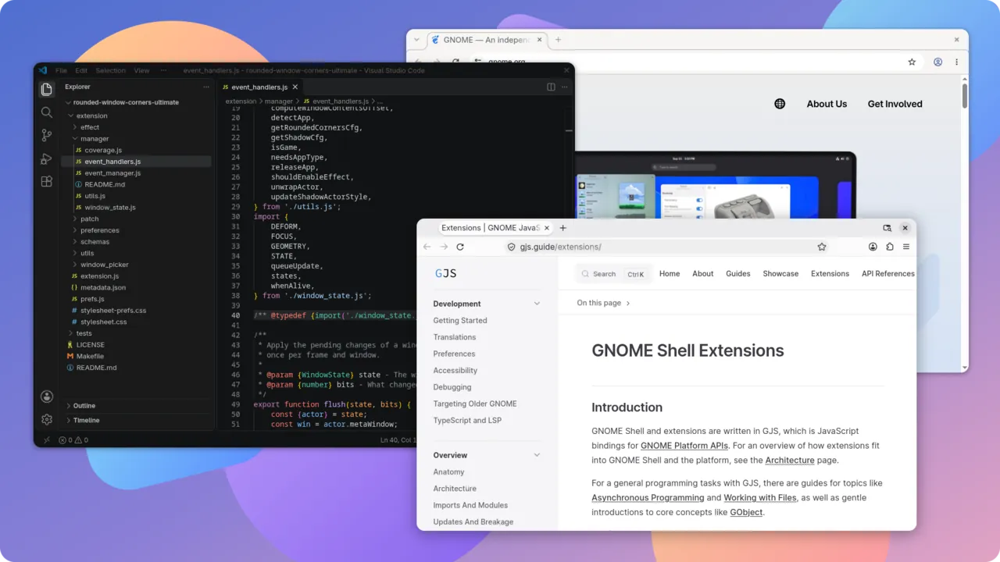

<div align="center">
  <h1>Rounded Window Corners Ultimate</h1>
  <p><i>Soft, rounded corners for every window on GNOME Shell 51</i></p>
</div>
<br>



Hi there! 👋 This is a personal fork of
[Rounded Window Corners Reborn](https://github.com/flexagoon/rounded-window-corners)
by flexagoon, which lovingly continues the original
[rounded-window-corners](https://github.com/yilozt/rounded-window-corners)
by yilozt. Both did the hard work, this fork just builds on top of it.

## What this fork is about

- **GNOME Shell 51 and upcoming releases, Wayland only.** Supporting only
  current versions keeps the code small and lets every change be tested
  properly.
- **Plain JavaScript, no build step.** Clone it, pack it, done.
- **Stable and light.** No effects on fullscreen windows and games. Many
  fixes started out in other forks of the extension; they were adapted here,
  and every commit says where they came from.
- **Looks like libadwaita, nothing to tune.** Every window gets the corners,
  outline and shadow of libadwaita windows. The only setting is an optional
  focus border.

The extension is not on extensions.gnome.org.

## What's different from Rounded Window Corners Reborn

**GNOME Shell 51**

- Runs on GNOME Shell 51, which removed the shader API the original used.

**Stability**

- No more crash when maximizing: effects are never changed in the middle
  of a frame.
- Each window updates at most once per frame, even while it is resized.
- No leftover shadows or errors when a window closes or the extension is
  turned off while work is still pending.

**Performance**

- No effect on fullscreen windows and borderless games that cover the
  whole monitor.
- Windows hidden behind an opaque fullscreen window are paused, so GNOME
  can skip drawing them.
- Shadows are pre-rendered images instead of an extra copy of every window.
- Sharp overview previews without a second rendering pass.
- Games never trigger a scan of their process memory map.

**Looks**

- Even, sharp borders at fractional scaling such as 125 % and 150 %.
- Corners and borders sit exactly on the window edge; before, they could
  be off by up to 2 pixels.
- The corner radius is limited correctly on small windows.
- Corners, outline and shadow follow libadwaita windows, in light and dark
  style alike. libadwaita apps keep their own, since they draw all this
  themselves.
- An optional focus border in the system's accent color marks the active
  window, libadwaita apps included.

**Compatibility**

- Works together with Blur my Shell's application blur.
- The shadow hides while the Compiz windows effect wobbles a window.

**Development**

- Plain JavaScript without a build step, unit tests, and smoke tests in a
  headless GNOME Shell 51.
- Ready-made zip files for every release.

## Made with AI 🤖

Full transparency: the code in this fork is written with the help of an AI
coding assistant. A human decides what gets built, reviews the changes and
tests them on a real desktop before they land. If you spot something odd,
please open an issue, that helps a lot!

## Installation

### From a release

1. Download `rounded-window-corners-ultimate@coffeebowl.shell-extension.zip`
   from the [latest release](https://github.com/coffeebowl/rounded-window-corners-ultimate/releases/latest).

2. Install it:

    ```bash
    gnome-extensions install --force rounded-window-corners-ultimate@coffeebowl.shell-extension.zip
    ```

3. Log out and back in, then enable it:

    ```bash
    gnome-extensions enable rounded-window-corners-ultimate@coffeebowl
    ```

### From source

1. Install the dependencies:
    - make
    - gettext
    - `gnome-extensions` (comes with GNOME Shell)

2. Build and install the extension:

    ```bash
    git clone https://github.com/coffeebowl/rounded-window-corners-ultimate
    cd rounded-window-corners-ultimate
    make install
    ```

3. Log out and back in, then enable it:

    ```bash
    gnome-extensions enable rounded-window-corners-ultimate@coffeebowl
    ```

Coming from Rounded Window Corners Reborn? Disable it first and log out
once. GJS keeps registered classes around until the session ends, so the two
would get in each other's way.

Updating from 51.0? Its settings are gone, their old values stay in dconf
but are no longer used. To clear them:

```bash
dconf reset -f /org/gnome/shell/extensions/rounded-window-corners-ultimate/
```

## Settings

There is just one: a border in the system's accent color around the focused
window, 1 to 10 pixels wide and off by default. Turn it on in the Extensions
app or with:

```bash
gnome-extensions prefs rounded-window-corners-ultimate@coffeebowl
```

It lies inside the window edge, where the outline would be. For bug reports,
`debug-mode` writes debug messages to the journal:

```bash
gsettings --schemadir ~/.local/share/gnome-shell/extensions/rounded-window-corners-ultimate@coffeebowl/schemas \
    set org.gnome.shell.extensions.rounded-window-corners-ultimate debug-mode true
```

## Development

Everything lives in `extension/` as plain GJS ES modules. These `make`
targets are all you need:

```bash
make pack     # Pack the extension into a zip file
make install  # Pack and install the extension
make test     # Run the unit tests (gjs -m)
make smoke    # Run the extension in a private headless GNOME Shell 51
make pot      # Update the translation template and .po files
make clean    # Delete the zip file
```

## Thanks ❤️

- [flexagoon/rounded-window-corners](https://github.com/flexagoon/rounded-window-corners)
  for Rounded Window Corners Reborn, the base of this fork.
- [yilozt/rounded-window-corners](https://github.com/yilozt/rounded-window-corners)
  for the original extension that started it all.
- Everyone who keeps improving the extension in their own fork. Many fixes
  and ideas here started out in one of them; each commit names its source.

## License

GPL-3.0-or-later, see [`LICENSE`](LICENSE).
